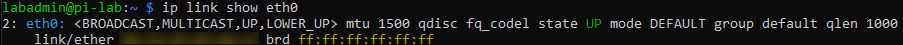
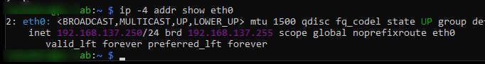

# Raspberry Pi SSH and Network Troubleshooting

## Overview

During my Raspberry Pi 5 homelab setup, I ran into an issue where I wasn't able to connect to my Raspberry Pi through SSH.

I discovered that the problem was related to the network connection and Windows Internet Connection Sharing.

My Windows 11 PC connects to the internet through Wi-Fi and shares that connection with my Raspberry Pi through Ethernet using my TP-Link Omada ES208G switch.

## Problems I Encountered

- SSH connection kept timing out.
- My Raspberry Pi wasn't receiving an IP address.
- DHCP was failing when trying to connect through Ethernet.
- The Pi could communicate with my PC but couldn't initially access the internet.
- Internet Connection Sharing wasn't forwarding the connection properly.

## 1. Checking the Network Connection

I first checked whether my Raspberry Pi was physically connected to the Ethernet switch.

I used these commands:

```bash
ip link show eth0
```

```bash
ip -4 addr show eth0
```

The Ethernet connection showed `LOWER_UP`, which meant the physical connection was detected.




However, the Pi wasn't receiving an IPv4 address.

I also checked the network devices:

```bash
nmcli device status
```

The Ethernet connection showed as disconnected.

## 2. Troubleshooting Windows

Since my Raspberry Pi was getting internet through my Windows PC, I checked the Windows network settings.

Things I checked:

- Ethernet adapter was enabled.
- Wi-Fi sharing was turned on.
- Internet Connection Sharing service was running.
- DHCP Client service was running.
- Ethernet had the address `192.168.137.1`.

I also checked Windows network information using:

```powershell
ipconfig
```

And:

```powershell
arp -a
```

These commands helped me check the network adapters and devices visible on my network.

## 3. Setting a Static IP Address

Because DHCP wasn't working properly, I temporarily assigned my Raspberry Pi a static IP address.

I used:

- Raspberry Pi IP: `192.168.137.250`
- Windows Ethernet IP: `192.168.137.1`
- Subnet mask: `255.255.255.0`
- Gateway: `192.168.137.1`
- DNS: `1.1.1.1`

This allowed me to reconnect to my Raspberry Pi without relying on its hostname.

This is a temporary IP while I troubleshoot on how to get DHCP working again!



## 4. Fixing Internet Connection Sharing

After checking the Windows settings, I discovered that Internet Connection Sharing was also enabled on an extra VirtualBox network adapter.

I disabled sharing on that adapter while keeping my main Wi-Fi and Ethernet sharing settings enabled.

After doing this, my Raspberry Pi was able to access the internet again.


## 5. Testing the Connection

I used ping to make sure the devices could communicate.

From my Raspberry Pi, I tested the Windows PC:

```bash
ping -c 4 192.168.137.1
```

I also tested internet connectivity:

```bash
ping -c 4 8.8.8.8
```

And checked whether DNS was working:

```bash
ping -c 4 google.com
```
I did not get a response from google but I did HTTPS tests which confirmed website access!

I also tested another website:

```bash
ping -c 4 mlb.com
```

Finally, I tested whether I could reconnect through SSH:

```powershell
ssh labadmin@192.168.137.250
```

I was able to reconnect successfully and confirmed that my Raspberry Pi had internet access.

## What I Learned

During this troubleshooting process, I learned:

- How to check Ethernet connections on Linux.
- How IP addresses work between devices.
- What DHCP does and why devices need an IP address.
- How Windows Internet Connection Sharing works.
- How to assign a static IP address.
- How to use ping to test network connections.
- How to troubleshoot SSH connection problems.
- How to identify problems between a computer and a network device.

## Final Result

I was able to restore SSH access and internet connectivity on my Raspberry Pi.

The biggest lesson I learned was that having a physical Ethernet connection doesn't necessarily mean a device has a working network connection. DHCP, IP addressing, and internet sharing all need to be configured correctly.

This was my first major networking troubleshooting experience while building my Raspberry Pi homelab.
